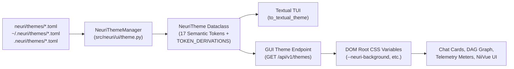
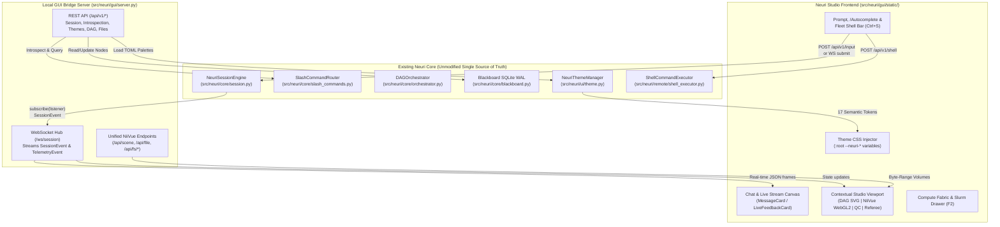

# Neuri GUI ("Neuri Studio") — Architecture & Implementation Design

> **Document Purpose:** Comprehensive architectural overview and step-by-step implementation blueprint for **Neuri Studio**, the full graphical user interface for Neuri.
> **Core Mandates:**
> 1. **Slick, Professional Aesthetic:** Clinical-grade neuroimaging workstation UI with zero hardcoded color literals, dynamically driven by the repository's TOML theme system (`neuri/themes/*.toml`).
> 2. **100% Terminal Feature Parity:** Every workflow, slash command, keyboard shortcut, shell mode, remote cluster monitor, and telemetry indicator from the Textual TUI (`NeuriChatApp`) is preserved and elevated.
> 3. **Future-Proof Extensibility:** Built on a strict **Thin-Frontend / Fat-Engine** introspection architecture so any future changes to `NeuriSessionEngine`, `SlashCommandRouter`, `Blackboard`, `NeuriConfig`, or `neuri/themes/` automatically propagate to the GUI without requiring frontend code changes.

---

## Part 1: Overview of the Design

### 1.1 Design Philosophy: "Clinical Precision Meets Agentic Control"

Neuri Studio is designed as a **hybrid AI research cockpit and neuroimaging workstation** (inspired by Linear, Cursor, RStudio, and FreeSurfer/FSLeyes). Rather than treating the GUI as a separate application that duplicates CLI logic, Neuri Studio is a **reactive graphical projection** of `NeuriSessionEngine` ([`src/neuri/core/session.py`](file:///Users/mszdjh3/code/neuri/src/neuri/core/session.py)) and `NiiVueBridge` ([`src/neuri/viewer/niivue_bridge.py`](file:///Users/mszdjh3/code/neuri/src/neuri/viewer/niivue_bridge.py)).

Key visual and ergonomic principles:
* **Zero Color Literals Rule:** Extending the exact rule enforced in [`src/neuri/ui/theme.py`](file:///Users/mszdjh3/code/neuri/src/neuri/ui/theme.py) and [`src/neuri/ui/terminal_chat.py`](file:///Users/mszdjh3/code/neuri/src/neuri/ui/terminal_chat.py), no widget or stylesheet in the GUI contains hardcoded hex colors. Every surface, border, glow, typography hierarchy, chart line, and status badge is bound to CSS Custom Properties (`var(--neuri-*)`) generated directly from `NeuriTheme` TOML files (`dark.toml`, `cyberpunk.toml`, `catppuccin.toml`, `monokai.toml`, `nord.toml`, `high_contrast.toml`, plus user themes in `~/.neuri/themes/`).
* **Unified Multi-Modal Workspace:** In the terminal, 3D neuroimaging (`/view`) opens an external browser window on port `8421`. In Neuri Studio, the **NiiVue WebGL2 3D/4D canvas**, **Interactive DAG Flow Graph**, **M/EEG Butterfly QA Plots**, and **Paperback Manuscript Editor** dock directly alongside the conversational stream in a customizable split-pane layout.
* **Keyboard-First Power User Ergonomics:** Every TUI shortcut (`F2` Machines, `F3` DAG Inspector, `Ctrl+S` Shell Mode, `Ctrl+L` Clear, `Up`/`Down` prompt history, `Tab` machine/command completion) works identically in the GUI, augmented by `Cmd+K` / `Ctrl+K` for a global Command Palette.

---

### 1.2 Master Workspace Layout

Neuri Studio uses a **4-Zone Adaptive Dock Layout** with smooth 150ms CSS grid transitions:

```
┌──────────────────────────────────────────────────────────────────────────────────────────────────┐
│ [>> NEURI]  Workspace: /code/study01 │ ● Global │ Harness: [agy ▾] │ Model: [default ▾] │ [🎨 ▾] │  <-- Zone A: Top Header Bar
├──────┬───────────────────────────────────────────────┬───────────────────────────────────────────┤
│      │  >> Neuri Chat & Execution Stream             │  Contextual Studio Viewport (Split Pane)  │
│  🧭  │  ───────────────────────────────────────────  │  [ 🕸️ DAG ] [ 🧠 NiiVue ] [ 📊 QC ] [ 📝 ] │
│      │  ┌─ Welcome / Quick Actions Card ──────────┐  │  ┌─────────────────────────────────────┐  │
│  💬  │  │ Modality • Quick Action • Command       │  │  │                                     │  │
│ Chat │  └─────────────────────────────────────────┘  │  │     Interactive 3D NiiVue WebGL2    │  │
│      │                                               │  │                 OR                  │  │
│  🕸️  │  ┃ › you  14:22:01                            │  │     Interactive Node-Link DAG       │  │
│ DAG  │  ┃ Preprocess sub-01 to sub-10 with fMRIPrep  │  │                 OR                  │  │
│ (F3) │                                               │  │     BIDS Matrix & QC Triage Table   │  │
│      │  ┃ >> specialist · node_fmriprep (live)       │  │                 OR                  │  │
│  🖥️  │  ┃ ▸ reasoning trace (collapsible)            │  │     5-Pass Referee Manuscript Diff  │  │
│ Fleet│  ┃ ⠋ [ Tool: validate_preflight_cohort · 12ms]│  │                                     │  │
│ (F2) │  ┃ Pre-flight check passed for 10 subjects... │  ├─────────────────────────────────────┤  │
│      │                                               │  │ Crosshair: MNI [-12, 24, 8] [Inject]│  │
│  🧠  ├───────────────────────────────────────────────┤  ├─────────────────────────────────────┤  │
│ View │  [ SHELL ] target ● localhost ○ hpc-cluster   │  │ 🖥️ Compute Fabric & Slurm Arrays    │  │
│      │  ┌─ Prompt / Slash / Shell Input ──────────┐  │  │ ● hpc-login  Load ████░░░░ 4.12     │  │
│  📚  │  │ › Type a research prompt, /cmd, or !sh  │  │  │   slurm #49102 [1-50%8]  48✓ 2⠋     │  │
│ Brain│  └─────────────────────────────────────────┘  │  │   [Reconcile] [Retry Failed]        │  │
│      │                                               │  └─────────────────────────────────────┘  │
├──────┴───────────────────────────────────────────────┴───────────────────────────────────────────┤
│ Harness: agy │ Model: default │ Machines: 2 online │ Tokens: ████░░ 18,420 │ Cost: $0.14 │ READY │  <-- Zone D: Telemetry Bar
└──────────────────────────────────────────────────────────────────────────────────────────────────┘
```

#### Zone Breakdown:
1. **Zone A — Top Header Banner (`#header-bar`)**:
   * Displays brand glyph (`>> neuri`), active workspace path selector, state badge (`● Global` / `● Project`), interactive **Harness Selector Pill** (`agy`, `codex`, `ollama`, `openclaw`, `opencode`), **Model Selector Pill**, **Theme Picker Dropdown** (with live hover preview), and `Cmd+K` Command Palette trigger.
2. **Zone B — Left Activity Rail & Primary Conversational Stream (`#chat-column`)**:
   * **Activity Rail (48px icon strip):** Instant toggles for Chat Stream, DAG Inspector (`F3`), Compute Fleet (`F2`), NiiVue 3D Viewer, BIDS & QC Dashboard, Brain Vault, and Paperback Writer.
   * **Scrollable Card Stream (`#chat-scroll`):** Renders `WelcomeCard`, `MessageCard` (user, assistant, shell), `LiveFeedbackCard` (streaming thinking traces, tool call pills, live markdown), `ShellCommandCard`, and `ShellResultCard`.
   * **Input Stack (`#input-container`):** Houses the floating `SlashAutocompletePopup`, `MachineSelectorBar` (visible when `Shell Mode` is active via `Ctrl+S` or `!`), and `PromptInput` with multi-line expansion, file/coordinate pill attachments, and bash-style history (`PromptHistoryManager`).
3. **Zone C — Contextual Studio Viewport & Inspector Drawers (`#studio-viewport`)**:
   * Collapsible right-hand split pane (can be toggled via `F2`/`F3` or dragged from 0% to 70% width) with tabbed workspaces:
     * **Tab 1: DAG Inspector & Visual Editor (`F3`)** — Interactive topological node-edge graph + node property inspector.
     * **Tab 2: NiiVue 3D/4D Neuroimaging Canvas (`/view`)** — Embedded WebGL2 volume/surface viewer with multi-layer opacity controls, `/view compare` co-registration mode, and 2-way crosshair coordinate feedback.
     * **Tab 3: Compute Fleet & Batch Jobs (`F2`)** — Real-time SSH host load meters, CPU counts, tmux worker sessions, and Slurm job array progress bars.
     * **Tab 4: BIDS & QC Triage (`/bids`, `NeuroQCTriageEngine`)** — Subject/modality completeness heatmaps, fMRIPrep motion (FD/DVARS) charts, MRIQC outlier tables, and M/EEG butterfly/PSD snapshots.
     * **Tab 5: Brain Vault & Paperback Studio (`/brain`, `/paperback`)** — Knowledge graph browser, 5-pass Referee audit annotations, and COBIDAS Methods synthesizer.
4. **Zone D — Live Telemetry Footer (`#telemetry-bar`)**:
   * Mirrors `TelemetryBar` from [`src/neuri/ui/terminal_chat.py`](file:///Users/mszdjh3/code/neuri/src/neuri/ui/terminal_chat.py#L1596-L1777): real-time token progress meter (`$tokens` vs `64,000` token budget), cumulative USD cost (`$cost`), online machine counter, active keyboard shortcut hints, and semantic status badge (`READY`, `RUNNING`, `SHELL`, `WAITING_OPERATOR`, `CIRCUIT_BREAKER`).

---

### 1.3 Seamless Theme Engine Integration (`neuri/themes/*.toml`)

A foundational requirement is native integration with the repository's themes (`dark`, `cyberpunk`, `catppuccin`, `monokai`, `high_contrast`, `nord`, and custom user `.toml` themes).



Every `NeuriTheme` instance defines 17 semantic color tokens (with automatic fallback derivation via `NeuriTheme.TOKEN_DERIVATIONS`). The GUI maps every single token 1-to-1 into CSS Custom Properties on `:root`:

| `NeuriTheme` Attribute | CSS Custom Property | GUI Visual Application |
| :--- | :--- | :--- |
| `background` | `--neuri-background` | Main canvas backdrop, terminal output background, NiiVue viewport surround |
| `foreground` | `--neuri-foreground` | Primary body copy, code block foreground, node titles |
| `surface` | `--neuri-surface` | Card backgrounds, input box fill, header/telemetry bar background |
| `surface_elevated` | `--neuri-surface-elevated` | Floating `SlashAutocompletePopup`, Command Palette modal, hover cards, tooltips |
| `panel` | `--neuri-panel` | Left activity rail, `ComputeSidebar` (`F2`), `DAGInspectorDrawer` (`F3`) |
| `border` | `--neuri-border` | 1px structural hairlines, card dividers, unfilled meter segments |
| `primary` | `--neuri-primary` | User message accent border, focused input ring, primary buttons, `/command` highlights |
| `secondary` | `--neuri-secondary` | Assistant (`>> neuri`) accent border, specialist role badges, DAG edge splines |
| `accent` | `--neuri-accent` | Active harness/theme pills, crosshair markers, interactive focus highlights |
| `warning` | `--neuri-warning` | `WAITING_OPERATOR` node state, high CPU load (>75%), QC outlier warnings |
| `error` | `--neuri-error` | `FAILED` node state, circuit breaker banner, stderr text, offline host dot |
| `success` | `--neuri-success` | `COMPLETED` node state, Shell Mode border (`Ctrl+S`), online host dot, exit 0 |
| `muted` | `--neuri-muted` | Timestamps, collapsed reasoning trace text, secondary labels, placeholder text |
| `selection_bg` | `--neuri-selection-bg` | Active autocomplete row, selected machine pill, text selection highlight |
| `selection_fg` | `--neuri-selection-fg` | Foreground text on selected rows and active pills |
| `tokens` | `--neuri-tokens` | Live token meter fill and token count typography |
| `cost` | `--neuri-cost` | Monetary USD tally badge and cost breakdown charts |

**Result:** Switching themes via `/theme cyberpunk` in the chat box OR selecting *Cyberpunk* / *Catppuccin* / *Nord* in the top bar immediately restyles the entire GUI—including SVG DAG nodes, NiiVue chrome, scrollbars, and syntax highlighting—in under 16ms with zero page reload.

---

### 1.4 Complete Terminal-to-GUI Feature Parity Matrix

Every feature and slash command in [`src/neuri/ui/terminal_chat.py`](file:///Users/mszdjh3/code/neuri/src/neuri/ui/terminal_chat.py) and [`src/neuri/core/slash_commands.py`](file:///Users/mszdjh3/code/neuri/src/neuri/core/slash_commands.py) has both a **direct CLI/slash equivalent** in the GUI prompt and a **rich graphical interaction**:

| Terminal Feature / Command | TUI Widget / Shortcut | GUI Equivalent & Enhanced Visual Experience |
| :--- | :--- | :--- |
| **Natural Language Prompt** | `PromptInput` -> `NeuriSessionEngine` | Multi-line auto-expanding prompt input + file/coordinate pill dropzone + live streaming cards |
| **Live Reasoning & Streaming** | `LiveFeedbackCard` | Collapsible animated *Reasoning Trace* drawer + live tool execution badges (`tool_name` on `host`, `ms`) |
| **Slash Autocomplete** | `SlashAutocompletePopup` (`/`) | Floating keyboard-navigable popup on `/` + `Cmd+K` global Command Palette with parameter hints |
| **Fleet Shell Mode** | `!<cmd>`, `/shell`, `Ctrl+S`, `Tab` | `Ctrl+S` or `SHELL` toggle button; `MachineSelectorBar` pills; ANSI-rendered stdout/stderr card |
| **Compute Sidebar** | `ComputeSidebar` (`F2` / `Ctrl+B`, `/machines`) | Live Compute Fabric drawer (`F2`) with SVG/CSS load meters, CPU core counts, and 1-click host bootstrap |
| **DAG Planning & Editing** | `/plan`, `/plan inspect`, `/plan edit`, `/plan set`, `/run`, `F3` | Interactive **DAG Flow Canvas** (`F3`): click any node to edit instruction, switch harness/model, or click **Run DAG** |
| **Circuit Breaker Recovery** | `/retry`, `/cancel` (`WAITING_OPERATOR`) | High-visibility warning banner on paused node card with **Retry Node** and **Cancel Workflow** buttons |
| **3D Neuroimaging Viewer** | `/view <path>`, `/view compare <f> <m>` | Embedded **NiiVue WebGL2 Viewport** tab: multi-layer controls, co-registration red-overlay slider, 2-way MNI crosshair click-to-prompt |
| **BIDS Pre-flight & QC** | `/bids summary`, `/bids validate` | Interactive **BIDS Cohort Matrix** (subjects × modalities) + MRIQC/fMRIPrep motion & Euler triage table + M/EEG butterfly PNG viewer |
| **Remote & Slurm Jobs** | `/remote`, `/jobs` | **Batch Queue Monitor**: live Slurm array progress (`1-50%8`), sub-task status grid, 1-click **Reconcile** & **Retry Failed Indices** |
| **Brain Knowledge Vault** | `/brain status\|search\|add\|consolidate` | **Brain Explorer**: dual-scope (`Global` / `Project`) search, category filter pills, observation editor, and consolidation trigger |
| **Researcher & NotebookLM** | `/researcher`, `/notebooklm` | Literature search cards with clickable DOI/PubMed badges, citation registration, and NotebookLM source query panel |
| **Paperback & Provenance** | `/paperback review\|methods\|cite`, `/export provenance` | **Referee Split-View**: 5-pass audit findings (`CRITICAL`/`MAJOR`/`MINOR`), British English diff highlights, and 1-click `dataset_description.json` export |
| **Harness, Model & Theme** | `/harness`, `/model`, `/theme` | Instant header dropdowns + full slash command compatibility |
| **Session & History** | `/convo`, `/history`, `/clear`, `Up`/`Down` | Session switcher sidebar, persistent `PromptHistoryManager` arrow navigation, and `Ctrl+L` canvas clear |

---

### 1.5 How Forward Compatibility with Future Neuri Changes is Guaranteed

To ensure that **any modification you make to Neuri in the future works automatically in the GUI**, the design enforces four architectural invariants:

1. **Zero Business Logic in the Frontend:**
   The GUI frontend never parses BIDS datasets, never talks to SQLite directly, never constructs SSH commands, and never formats prompts. Every user action either calls `NeuriSessionEngine.submit_user_input(text)` or invokes a thin REST/WebSocket wrapper around existing core classes (`NeuriSessionEngine`, `SlashCommandRouter`, `NeuriThemeManager`, `Blackboard`, `NiiVueBridge`).
2. **Runtime Slash Command Introspection (`/api/v1/introspect/commands`):**
   Instead of maintaining a separate list of slash commands in the GUI, an introspection service inspects `SlashCommandRouter` at runtime (reading docstrings, parameter signatures, and `SlashAutocompletePopup.SLASH_COMMANDS`). Whenever you add a new `_handle_<cmd>` method in [`src/neuri/core/slash_commands.py`](file:///Users/mszdjh3/code/neuri/src/neuri/core/slash_commands.py), it automatically populates the GUI's `/` autocomplete menu and `Cmd+K` Command Palette.
3. **Runtime Pydantic JSON Schema Reflection (`/api/v1/introspect/schemas`):**
   All forms and inspectors in the GUI (such as `TaskNode` inspection, `NeuriConfig` settings, and `RemoteArtifact` metadata) render dynamically from `Model.model_json_schema()` on the Pydantic models in [`src/neuri/core/schemas.py`](file:///Users/mszdjh3/code/neuri/src/neuri/core/schemas.py) and [`src/neuri/core/config.py`](file:///Users/mszdjh3/code/neuri/src/neuri/core/config.py). Adding a field to `NeuriConfig` or `TaskNode` automatically surfaces it in the GUI inspector.
4. **Universal Markdown + Structured Data Contract (`SlashCommandResult`):**
   Every slash command returns `SlashCommandResult(command, success, markdown_output, data, action)`.
   * If a command returns custom structured `data` that has a specialized GUI visualizer (e.g., `workflow_id` for DAGs, `viewer_url` for NiiVue, `cohort` for `/bids`), the GUI updates the corresponding Studio Viewport tab *and* renders `markdown_output` in the chat stream.
   * If you add a brand-new slash command tomorrow with no specialized GUI widget, the GUI still renders its `markdown_output` (tables, alerts, code blocks, links) in a themed `MessageCard` and inspects its `data` dictionary as a collapsible JSON tree—giving immediate 100% functionality with zero GUI code changes.

---

## Part 2: How to Implement It

### 2.1 High-Level System Architecture

Neuri Studio is implemented as a self-contained Python package under `src/neuri/gui/` that embeds an asynchronous local ASGI/HTTP + WebSocket bridge and launches either a native desktop window (via `pywebview` if installed) or an app-mode desktop browser window.



---

### 2.2 Directory & File Structure

All new GUI code resides cleanly inside `src/neuri/gui/` with minimal, non-invasive hooks in `src/neuri/cli/main.py` and `src/neuri/ui/theme.py`:

```text
src/neuri/
├── cli/
│   └── main.py                  # Add `neuri gui` subcommand and `--gui` / `-g` flag
├── ui/
│   ├── theme.py                 # Add `to_css_variables()` and `to_dict()` on NeuriTheme
│   ├── history.py               # Reused directly by GUI Bridge for prompt history
│   └── terminal_chat.py         # Existing Textual TUI (untouched, 100% preserved)
└── gui/
    ├── __init__.py              # Exports NeuriGUIServer, NeuriGUIApp
    ├── introspect.py            # Runtime introspection of SlashCommandRouter & Pydantic schemas
    ├── server.py                # Asyncio/Threading HTTP + SSE/WebSocket server & API router
    ├── launcher.py              # Native desktop window launcher (pywebview / app-mode browser)
    └── static/
        ├── index.html           # Master 4-Zone application shell
        ├── css/
        │   └── studio.css       # Semantic CSS using ONLY var(--neuri-*) custom properties
        └── js/
            ├── app.js           # Core state store, event bus, and keyboard shortcut router
            ├── theme_engine.js  # Applies NeuriTheme tokens to DOM & WebGL canvases
            ├── chat_stream.js   # MessageCard, LiveFeedbackCard, Markdown & Reasoning Trace
            ├── dag_canvas.js    # Interactive SVG DAG topological renderer & node editor
            ├── niivue_panel.js  # Embedded NiiVue 3D/4D viewport & 2-way crosshair bridge
            ├── fleet_panel.js   # ComputeSidebar (F2), Slurm arrays, and MachineSelectorBar
            └── studio_tabs.js   # BIDS matrix, QC triage tables, Brain vault, Paperback referee
```

---

### 2.3 Step-by-Step Implementation Specification

#### Step 1: Extend `NeuriTheme` with CSS Custom Property Export (`src/neuri/ui/theme.py`)

In [`src/neuri/ui/theme.py`](file:///Users/mszdjh3/code/neuri/src/neuri/ui/theme.py), add two pure methods to `NeuriTheme` so any theme TOML file can be serialized into CSS Custom Properties and JSON:

```python
def to_css_variables(self) -> dict[str, str]:
    """Export all semantic theme tokens as CSS custom property key-value pairs.

    Parameters
    ------------
    None

    Returns
    --------
        dict[str, str]: dict object
            Mapping of '--neuri-<token>' CSS variable names to hex color strings.
    """
    css_vars: dict[str, str] = {
        "--neuri-background": self.background,
        "--neuri-foreground": self.foreground,
        "--neuri-surface": self.surface,
        "--neuri-surface-elevated": self.surface_elevated,
        "--neuri-panel": self.panel,
        "--neuri-border": self.border,
        "--neuri-primary": self.primary,
        "--neuri-secondary": self.secondary,
        "--neuri-accent": self.accent,
        "--neuri-warning": self.warning,
        "--neuri-error": self.error,
        "--neuri-success": self.success,
        "--neuri-muted": self.muted,
        "--neuri-selection-bg": self.selection_bg,
        "--neuri-selection-fg": self.selection_fg,
        "--neuri-tokens": self.tokens,
        "--neuri-cost": self.cost,
    }
    return css_vars
```

Because `NeuriTheme.__post_init__` already normalizes 3-, 4-, 6-, and 8-digit hex codes via `normalize_color()` and resolves any omitted tokens via `TOKEN_DERIVATIONS`, the GUI is guaranteed to receive a complete, valid 17-token palette for every built-in or user-created `.toml` file.

---

#### Step 2: Build the Runtime Introspection Engine (`src/neuri/gui/introspect.py`)

To guarantee that future additions to Neuri automatically appear in the GUI without modifying frontend code, implement `NeuriIntrospector`:

1. **`discover_slash_commands(router: SlashCommandRouter) -> list[dict[str, Any]]`**:
   * Starts with `SlashAutocompletePopup.SLASH_COMMANDS` for canonical descriptions.
   * Dynamically scans all `_handle_<name>` methods on `SlashCommandRouter` using `inspect.getmembers(router, predicate=inspect.ismethod)`.
   * Extracts the first line of each `_handle_<name>` docstring and parses subcommand branches (e.g., `subcmd == "validate"`, `subcmd == "summary"`) so even newly added `_handle_*` methods or subcommands are automatically registered with their descriptions and argument hints.
2. **`discover_harnesses_and_models(session_engine: NeuriSessionEngine) -> dict[str, Any]`**:
   * Queries `AdapterRegistry` ([`src/neuri/adapters/registry.py`](file:///Users/mszdjh3/code/neuri/src/neuri/adapters/registry.py)) and `SlashCommandRouter._handle_model(["list"])` to dynamically list all registered harnesses (`agy`, `codex`, `ollama`, `openclaw`, `opencode`) and their available models.
3. **`export_pydantic_schemas() -> dict[str, Any]`**:
   * Exports `.model_json_schema()` for `NeuriTaskEnvelope`, `TaskNode`, `RemoteArtifact`, `NiiVueSceneSpec`, and `NeuriConfig` so the GUI's node editor and settings modal dynamically build inputs for any new schema fields.

---

#### Step 3: Implement the Unified GUI Bridge Server (`src/neuri/gui/server.py`)

Create `NeuriGUIServer`, which wraps `NeuriSessionEngine`, `PromptHistoryManager`, `ShellCommandExecutor`, `NeuriThemeManager`, and `NiiVueBridge` into a single localhost server (defaulting to `127.0.0.1:8420`, with automatic port discovery if `8420` is busy):

##### Core HTTP & Streaming Endpoints:

| Endpoint | Method | Responsibility & Underlying Core Call |
| :--- | :--- | :--- |
| `/` | `GET` | Serves `src/neuri/gui/static/index.html` and static JS/CSS assets. |
| `/api/v1/events` | `GET` (SSE) | Server-Sent Events stream subscribed to `NeuriSessionEngine.subscribe()`. Pushes every `SessionEvent` (`USER_MESSAGE`, `ASSISTANT_CHUNK`, `THINKING_CHUNK`, `TOOL_CALL_UPDATE`, `STATUS_UPDATE`, `WORKFLOW_COMPLETED`, `CIRCUIT_BREAKER_TRIGGERED`) in real time with zero external WebSocket library dependencies! |
| `/api/v1/state` | `GET` | Returns full workspace snapshot: `workspace_dir`, `session_id`, `harness`, `model`, `active_theme`, `turns`, `workflows`, `active_nodes`, `machines`, and `telemetry` (tokens, cost, status). |
| `/api/v1/input` | `POST` | Accepts `{"text": "..."}`. Records in `PromptHistoryManager`, invokes `await session_engine.submit_user_input(text)`, and returns the resulting `ChatTurn` + any structured `SlashCommandResult.data`. |
| `/api/v1/shell` | `POST` | Accepts `{"command": "...", "host": "..."}`. Invokes `await session_engine.execute_shell_command(command, host)` and returns structured `ShellExecutionResult` (`stdout`, `stderr`, `exit_code`, `duration_seconds`, `host`). |
| `/api/v1/history` | `GET` / `POST` | Interfaces with `PromptHistoryManager` (`navigate_up`, `navigate_down`, `get_entries`, `clear`) so `Up`/`Down` arrows in the GUI share the exact `~/.neuri/history` file used by the terminal. |
| `/api/v1/themes` | `GET` / `POST` | `GET` lists all themes via `NeuriThemeManager.list_available_themes()` with their `to_css_variables()` maps. `POST` calls `theme_manager.set_active_theme(name)` and broadcasts a `theme_changed` event. |
| `/api/v1/dag` | `GET` / `PATCH` | `GET` returns `blackboard.list_nodes(workflow_id)` and edges for topological SVG rendering. `PATCH` delegates directly to `/plan edit <node_id> <instruction>` and `/plan set <node_id> <harness> [model]`. |
| `/api/v1/machines` | `GET` | Executes the same non-blocking machine health & Slurm poll used by `NeuriChatApp._poll_machines_worker()` (`ComputeSidebar` data). |
| `/api/v1/introspect` | `GET` | Returns dynamic slash command catalog, harness/model registry, and Pydantic JSON schemas from `NeuriIntrospector`. |
| `/api/scene/*`, `/api/file/*`, `/api/fs/*` | `GET` / `POST` | Mounts all `NiiVueBridgeHandler` endpoints directly on the same server so the embedded NiiVue WebGL2 canvas streams local and `ssh://` volumes seamlessly. |

> [!TIP]
> **Why SSE (`text/event-stream`) + Standard `http.server.ThreadingHTTPServer`?**
> Using Python's standard library `ThreadingHTTPServer` with Server-Sent Events (`/api/v1/events`) and JSON `POST` requests means **zero additional third-party server dependencies** (no FastAPI/uvicorn required, though compatible if added later), 100% sandbox/offline reliability, automatic browser reconnection, and sub-millisecond streaming latency for `ASSISTANT_CHUNK` and `THINKING_CHUNK` deltas.

---

#### Step 4: Frontend Architecture & Styling (`src/neuri/gui/static/`)

##### 4.1 Zero-Literal CSS Architecture (`css/studio.css`)
Every visual rule in `studio.css` references `--neuri-*` custom properties:

```css
:root {
  /* Populated dynamically by theme_engine.js from NeuriTheme.to_css_variables() */
  --neuri-font-sans: "Inter", -apple-system, BlinkMacSystemFont, "Segoe UI", sans-serif;
  --neuri-font-mono: "JetBrains Mono", "SF Mono", "Fira Code", ui-monospace, monospace;
}

body {
  background-color: var(--neuri-background);
  color: var(--neuri-foreground);
  font-family: var(--neuri-font-sans);
}

.message-card {
  background-color: var(--neuri-surface);
  border: 1px solid var(--neuri-border);
  border-radius: 8px;
}

.message-card-user {
  border-left: 3px solid var(--neuri-primary);
}

.message-card-assistant {
  border-left: 3px solid var(--neuri-secondary);
}

.message-card-shell {
  border-left: 3px solid var(--neuri-success);
}

.prompt-container:focus-within {
  border-color: var(--neuri-primary);
  box-shadow: 0 0 0 2px color-mix(in srgb, var(--neuri-primary) 25%, transparent);
}

.prompt-container.shell-mode {
  border-color: var(--neuri-success);
}
```

##### 4.2 Interactive Components (`js/`)

1. **`theme_engine.js` — Live Theme Synchronization**:
   * Fetches `/api/v1/themes` on startup and applies `document.documentElement.style.setProperty(key, val)` for all 17 tokens.
   * Updates the embedded NiiVue canvas background (`nv.opts.backColor`) and crosshair color (`nv.opts.crosshairColor`) to match `--neuri-background` and `--neuri-accent` automatically.
2. **`chat_stream.js` — Rich Conversational Cards & Live Telemetry Streaming**:
   * Renders the initial `WelcomeCard` quick-action table (clicking any row in the table—such as `/plan`, `/view`, `/status`, `/jobs`, `/bids`—populates or executes the command).
   * Handles SSE events from `/api/v1/events`:
     * On `THINKING_CHUNK`: Opens/updates the collapsible *Reasoning Trace* drawer on the active `LiveFeedbackCard` with a subtle pulsing `--neuri-secondary` indicator.
     * On `TOOL_CALL_UPDATE`: Renders an inline pill `[ ⚙️ tool_name · host · status · duration_ms ]`.
     * On `ASSISTANT_CHUNK`: Streams incremental Markdown tokens into the card body.
     * On `CIRCUIT_BREAKER_TRIGGERED`: Highlights the card in `--neuri-error` and renders interactive **Retry Node (`/retry`)** and **Cancel (`/cancel`)** action buttons.
3. **`dag_canvas.js` — Interactive Topological DAG Editor (`F3`)**:
   * Computes layered topological ranks (Wave 0, Wave 1, Wave 2...) from `Blackboard` nodes and edges.
   * Renders an interactive pan/zoom SVG graph with cubic Bézier edge connectors styled with `--neuri-border` (or animated dashed `--neuri-primary` lines when `RUNNING`).
   * Clicking any node opens the **Node Inspector Slide-Over**, allowing the user to:
     * Edit `task_instruction` in a multi-line editor (calls `/plan edit <node_id> <new_instruction>`),
     * Change `harness_id` and `model` via dropdowns (calls `/plan set <node_id> <harness> <model>`),
     * Inspect input/output `RemoteArtifact` SHA-256 hashes,
     * Execute the planned workflow via the **Run Workflow (`/run`)** primary button.
4. **`niivue_panel.js` — Docked 3D/4D WebGL2 Neuroimaging Studio**:
   * Embeds the NiiVue WebGL2 canvas directly inside the Studio Viewport tab.
   * Automatically activates whenever `/view <path>` or `/view compare <fixed> <moving>` is executed.
   * **Co-registration Inspector Mode:** When `/view compare` is active, displays an interactive opacity blend slider (0% to 100%) and colormap selector between the reference anatomical volume and moving functional/diffusion overlay.
   * **2-Way Coordinate Feedback:** Clicking any voxel in the 3D brain sends `POST /api/scene/selection` with `[x, y, z]` MNI coordinates and displays an **"+ Attach MNI [x, y, z] to Prompt"** button so the user can ask spatial questions directly to the agent.
5. **`fleet_panel.js` — Compute Fabric (`F2`) & Shell Mode (`Ctrl+S`)**:
   * Renders live host health cards (`localhost` + SSH cluster hosts) with load bars (`--neuri-primary`, `--neuri-warning`, `--neuri-error`), CPU core counts, active Neuri worker processes, and Slurm job arrays.
   * Includes a **"+ Bootstrap Remote Host"** modal (`/remote bootstrap <host>`) and per-job **Reconcile** / **Retry Failed Array Indices** buttons.
   * Manages the bottom `MachineSelectorBar` when `Shell Mode` (`Ctrl+S`) is active, supporting `Tab` / `Shift+Tab` host cycling identical to the TUI.
6. **`studio_tabs.js` — BIDS Matrix, QC Triage, Brain Vault & Paperback Referee**:
   * **BIDS & QC Tab:** Renders the output of `/bids summary` and `/bids validate` as a color-coded Subject × Modality readiness grid, displays `NeuroQCTriageEngine` outlier tables (FD, DVARS, tSNR, Euler number), and previews headless QA PNGs (orthoviews and M/EEG butterfly montages).
   * **Brain & Paperback Tab:** Provides a live search bar over `/brain search`, a 1-click `/brain consolidate` button, a **5-Pass Referee Audit** split editor (`/paperback review`), and a **COBIDAS Methods & Provenance Exporter** (`/paperback methods`, `/export provenance`).

---

#### Step 5: Native Desktop Launcher & CLI Integration (`src/neuri/gui/launcher.py` & `src/neuri/cli/main.py`)

1. **`NeuriGUILauncher` (`src/neuri/gui/launcher.py`)**:
   * Starts `NeuriGUIServer` on a background daemon thread.
   * Checks if `webview` (`pywebview`) is installed:
     * If available, opens a native OS desktop window (`webview.create_window("Neuri Studio", url, width=1440, height=900, min_size=(960, 600))`).
     * If `pywebview` is not installed, automatically launches the user's browser in app mode (or standard tab via `webbrowser.open(url)`) and keeps the server event loop alive until `Ctrl+C` or `/exit`.
2. **CLI Entrypoint (`src/neuri/cli/main.py`)**:
   * Add `--gui` / `-g` option to `neuri` main callback and a `neuri gui` subcommand:
     * `neuri` -> Launches the interactive Textual TUI (preserving existing default behavior).
     * `neuri --gui` or `neuri gui` -> Launches **Neuri Studio** GUI on the current workspace.
     * `neuri gui --port 8420 --no-browser` -> Starts the GUI server headlessly (ideal for SSH port-forwarding from a remote workstation!).

---

### 2.4 Coding Standards & Verification Plan

All Python modules in `src/neuri/gui/` must strictly adhere to `/Users/mszdjh3/.gemini/config/rules/python_standard.md`:
* **PEP 8 Compliance:** 4-space indentation, `snake_case` functions/variables, `PascalCase` classes, strict 79–88 character line limits.
* **Complete Type Annotations:** Full type hints on every function argument, return value, and class attribute.
* **Docstring Standard:** Every class, method, and function documented with the mandatory `Parameters` and `Returns` multi-line format.
* **Zero Global Variables:** All state encapsulated within `NeuriGUIServer`, `NeuriIntrospector`, and `NeuriGUILauncher` class instances.
* **Single Responsibility & Single Return Variable:** Each method performs one well-defined action and returns a single typed variable.

#### Automated Test Suite (`tests/unit/test_gui_studio.py`):
1. **`test_theme_css_variable_export`**: Verifies `NeuriTheme.to_css_variables()` across all 6 repository themes (`dark`, `cyberpunk`, `catppuccin`, `monokai`, `high_contrast`, `nord`), asserting 0 missing tokens and valid hex normalization.
2. **`test_runtime_introspector_auto_discovers_new_commands`**: Dynamically attaches a mock `_handle_custom_test_cmd` to `SlashCommandRouter` and verifies `NeuriIntrospector.discover_slash_commands()` automatically includes it in the GUI command catalog without frontend changes.
3. **`test_gui_server_state_and_input_roundtrip`**: Starts `NeuriGUIServer` on an ephemeral port, queries `GET /api/v1/state`, posts `/status` and `/theme nord` to `POST /api/v1/input`, and verifies SSE event emission and theme persistence.
4. **`test_gui_server_shell_and_dag_endpoints`**: Verifies `POST /api/v1/shell` (`echo hello` on `localhost`) and `GET / PATCH /api/v1/dag` node instruction/harness editing.
5. **`test_standards_compliance`**: Runs `tests/unit/test_standards_compliance.py` over all new files in `src/neuri/gui/` to guarantee zero PEP 8, docstring, or line-length violations.
