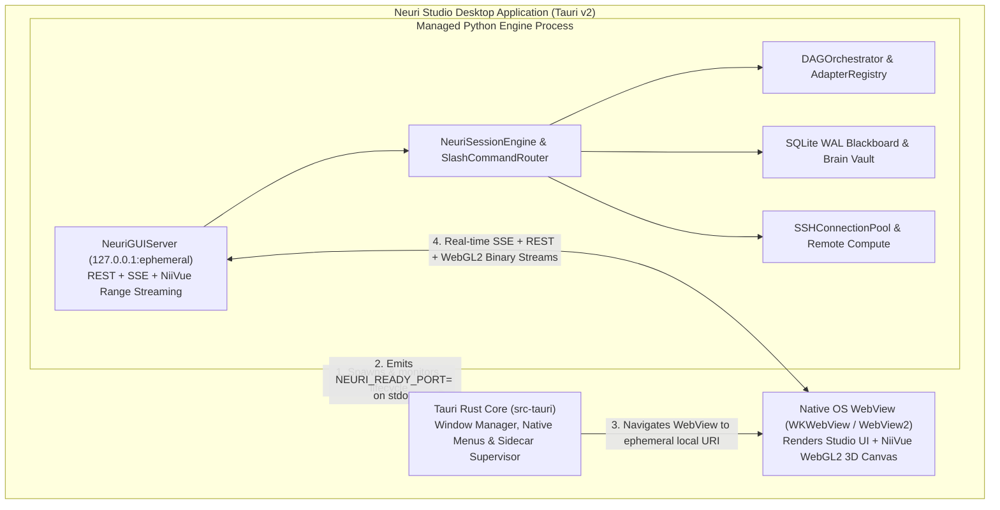
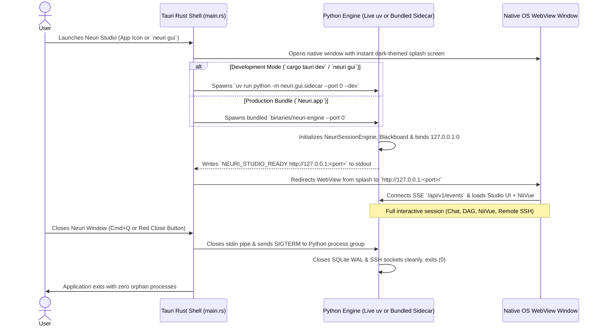
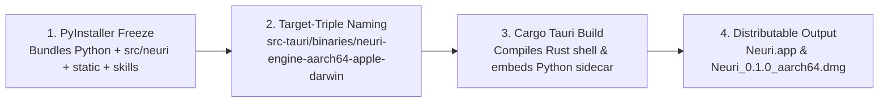

# Neuri Studio — Tauri v2 Standalone Desktop & Live-Dev Architecture Plan (`tauri.md`)

## 1. Executive Summary & Objectives

Currently, launching Neuri Studio ([`src/neuri/gui/launcher.py`](file:///Users/mszdjh3/code/neuri/src/neuri/gui/launcher.py)) binds an HTTP server to a local port and opens a browser tab in Google Chrome (`webbrowser.open`). While functional, this exposes terminal port plumbing and relies on an external web browser rather than behaving as a self-contained desktop application.

The objective of this plan is to wrap Neuri Studio in **Tauri v2**, transforming it into a **native standalone desktop application** (`Neuri.app` / `.dmg` on macOS, `.msi` / `.exe` on Windows, `.AppImage` / `.deb` on Linux) while preserving **real-time live development** whenever Python or UI files are edited.

### Core Design Pillars

1. **No Chrome, No Exposed Terminal Workflow:** Launching Neuri opens a dedicated native OS window (`WKWebView` on macOS, `WebView2` on Windows, `WebKitGTK` on Linux) with its own dock icon, native title bar, and OS menu bar.
2. **Instant Real-Time Development Mode (`Dev Mode`):**
   - **Frontend edits** (HTML, CSS, JS, icons, layout in [`src/neuri/gui/static/`](file:///Users/mszdjh3/code/neuri/src/neuri/gui/static/index.html) and [`src/neuri/viewer/static/`](file:///Users/mszdjh3/code/neuri/src/neuri/viewer/static/index.html)) appear **instantly** without recompiling Rust or restarting the app.
   - **Python backend edits** (agents, orchestrator, slash commands, themes in [`src/neuri/`](file:///Users/mszdjh3/code/neuri/__init__.py)) automatically hot-reload the live `uv` Python process in the background (~0.5s) while the Tauri desktop window stays open.
3. **Single-File Downloadable Distribution (`Build Mode`):**
   - Freezes the Python interpreter, dependencies, and Neuri package into a standalone sidecar binary embedded inside `Neuri.app` / `Neuri.dmg` so end-users can download and double-click a single application with zero prerequisites.
4. **100% Feature Parity & Zero Rewrite:**
   - Retains 100% of [`NeuriSessionEngine`](file:///Users/mszdjh3/code/neuri/src/neuri/core/session.py), [`DAGOrchestrator`](file:///Users/mszdjh3/code/neuri/src/neuri/core/orchestrator.py), SQLite [`Blackboard`](file:///Users/mszdjh3/code/neuri/src/neuri/core/blackboard.py), [`SlashCommandRouter`](file:///Users/mszdjh3/code/neuri/src/neuri/core/slash_commands.py), [`NeuriIntrospector`](file:///Users/mszdjh3/code/neuri/src/neuri/gui/introspect.py), [`SSHConnectionPool`](file:///Users/mszdjh3/code/neuri/src/neuri/remote/ssh_pool.py), and the embedded WebGL2 NiiVue 3D viewer.

---

## 2. System Architecture Overview

### 2.1 High-Level Component Diagram



### 2.2 Why an Internal Ephemeral Loopback Bridge + Sidecar?

In Tauri v2, there are two ways a WebView communicates with a backend: Tauri IPC commands (`invoke()`) or a managed loopback stream. For Neuri, combining **Tauri process management** with an **internal ephemeral loopback socket (`127.0.0.1:0`)** is critical because:
* **NiiVue 3D Volume Streaming:** Neuroimaging volumes (`.nii.gz`, `.mgz`) are 10–200 MB binary files that require HTTP `206 Partial Content` byte-range streaming ([`niivue_bridge.py`](file:///Users/mszdjh3/code/neuri/src/neuri/viewer/niivue_bridge.py)). Passing 100 MB arrays over JSON IPC serializes them into slow base64 strings, whereas internal loopback binary streaming transfers directly into WebGL2 typed arrays at memory speed.
* **Server-Sent Events (SSE):** [`NeuriGUIServer`](file:///Users/mszdjh3/code/neuri/src/neuri/gui/server.py) already streams live LLM token deltas, DAG node state updates, and theme changes over `/api/v1/events`.
* **Zero Fixed Port Conflicts:** Binding to `127.0.0.1:0` lets the OS kernel assign an unused ephemeral port dynamically on startup, which is communicated directly to Tauri via `stdout` pipe—meaning the user never sees a port number or deals with port collisions.

### 2.3 Startup, Handshake & Clean Shutdown Sequence



---

## 3. Repository & Directory Structure

We will add a self-contained `src-tauri/` directory at the repository root alongside a dedicated sidecar entrypoint in [`src/neuri/gui/`](file:///Users/mszdjh3/code/neuri/src/neuri/gui/__init__.py). No existing files in [`src/neuri/core/`](file:///Users/mszdjh3/code/neuri/src/neuri/core/__init__.py) need to be restructured.

```text
neuri/
├── pyproject.toml
├── tauri.md
├── src/
│   └── neuri/
│       ├── cli/
│       │   └── main.py                  # Updates `neuri gui` to launch Tauri window
│       ├── gui/
│       │   ├── __init__.py
│       │   ├── launcher.py              # Removes `webbrowser.open`, manages Tauri/sidecar launch
│       │   ├── sidecar.py               # NEW: Entrypoint emitting handshake + parent-PID watchdog
│       │   ├── hot_reload.py            # NEW: Dev-mode file watcher for .py and static assets
│       │   ├── server.py                # Adds no-cache dev headers & native dialog bridge endpoint
│       │   └── static/                  # Existing HTML/CSS/JS (100% reused)
│       │       ├── index.html
│       │       ├── splash.html          # NEW: Lightweight instant loading screen
│       │       ├── css/studio.css
│       │       └── js/
│       │           ├── app.js
│       │           ├── desktop_bridge.js # NEW: Tauri native OS integration wrapper
│       │           └── ...
│       └── viewer/
│           └── static/                  # Existing NiiVue WebGL2 viewer (100% reused)
└── src-tauri/                           # NEW: Tauri v2 Native Desktop Shell
    ├── Cargo.toml                       # Rust dependencies (tauri v2, tauri-plugin-shell, dialog)
    ├── build.rs                         # Standard Tauri build hook
    ├── tauri.conf.json                  # Window geometry, bundle ID, sidecar & icon config
    ├── capabilities/
    │   └── default.json                 # Tauri v2 permissions (shell sidecar, native file dialog)
    ├── icons/                           # App icons (.icns for macOS, .ico for Windows, .png)
    ├── binaries/                        # Target dir for PyInstaller sidecar in production builds
    └── src/
        ├── main.rs                      # Entrypoint
        └── lib.rs                       # Spawns Python engine, reads port, manages window & exit
```

---

## 4. Real-Time Live Development Workflow (`Dev Mode`)

> [!IMPORTANT]
> A primary requirement is that modifying any UI element (e.g., removing an icon, changing CSS, updating [`dag_canvas.js`](file:///Users/mszdjh3/code/neuri/src/neuri/gui/static/js/dag_canvas.js)) or modifying any Python file (e.g., [`orchestrator.py`](file:///Users/mszdjh3/code/neuri/src/neuri/core/orchestrator.py) or [`slash_commands.py`](file:///Users/mszdjh3/code/neuri/src/neuri/core/slash_commands.py)) reflects in real time **without** running a slow build step.

### 4.1 How Frontend Changes Update in Real Time (HTML / CSS / JS)

1. **Direct Workspace Serving:** [`NeuriGUIServer`](file:///Users/mszdjh3/code/neuri/src/neuri/gui/server.py) serves static files directly from [`src/neuri/gui/static/`](file:///Users/mszdjh3/code/neuri/src/neuri/gui/static/index.html) and [`src/neuri/viewer/static/`](file:///Users/mszdjh3/code/neuri/src/neuri/viewer/static/index.html) on disk—it never serves from a copied build folder during development.
2. **Zero Browser Caching in Dev Mode:** In [`server.py`](file:///Users/mszdjh3/code/neuri/src/neuri/gui/server.py), static responses include `Cache-Control: no-store, no-cache, must-revalidate` so the WebView never caches stale JS or CSS.
3. **Automatic Live Reload (`hot_reload.py`):**
   - A lightweight background thread in `src/neuri/gui/hot_reload.py` polls modification timestamps (`mtime`) on `src/neuri/gui/static/**/*` and `src/neuri/viewer/static/**/*` every `400ms`.
   - When you save a change to `index.html`, `studio.css`, or any `.js` file, the server emits a `SessionEventType.STATUS_UPDATE` (`{"action": "live_reload_assets"}`) over the existing SSE stream.
   - If a `.css` file changed, [`app.js`](file:///Users/mszdjh3/code/neuri/src/neuri/gui/static/js/app.js) hot-swaps the `<link rel="stylesheet">` tag in-place without losing scroll position. If `.html` or `.js` changed, it triggers `window.location.reload()` automatically. You can also press **`Cmd + R`** at any time.

### 4.2 How Python Backend Changes Update in Real Time (`.py` files)

1. **Live `uv` Environment Execution:** In development mode, Tauri does **not** run a compiled binary. Instead, Rust detects dev mode (`cfg!(debug_assertions)`) and spawns:
   ```bash
   uv run python -m neuri.gui.sidecar --workspace <dir> --dev
   ```
2. **Supervisor Auto-Restart on `.py` Save:**
   - When `--dev` is active, `sidecar.py` runs a tiny file-watcher over `src/neuri/**/*.py`.
   - When you edit and save any Python file (such as adding a command in [`slash_commands.py`](file:///Users/mszdjh3/code/neuri/src/neuri/core/slash_commands.py)), the worker process gracefully restarts itself on the same port in **~0.4 seconds**.
   - Because all conversation turns, DAG nodes, and artifacts are persisted in SQLite [`Blackboard`](file:///Users/mszdjh3/code/neuri/src/neuri/core/blackboard.py), and the frontend `EventSource` (`/api/v1/events`) automatically reconnects and re-fetches `/api/v1/introspect` and `/api/v1/state`, your new Python functionality immediately appears in the open Tauri window without losing your session.

### 4.3 Configuring `src-tauri/Cargo.toml` & `tauri.conf.json` for Zero Unnecessary Rust Rebuilds

> [!TIP]
> By default, Tauri watches its own `src-tauri/` directory. We will explicitly ensure `src/neuri/` is **excluded** from Cargo's Rust watcher so editing Python or JS files never triggers a Rust recompilation. Rust only compiles **once** on initial setup.

---

## 5. Standalone Production Packaging (`Build Mode`)

When you want to package Neuri Studio into a single downloadable application (`Neuri.app` / `Neuri.dmg`) for distribution or local installation in `/Applications`, a single build script (`scripts/build_desktop.py` or `neuri gui --build`) executes a two-stage pipeline:



### Stage 1: Freezing the Python Engine into a Sidecar Binary

Using **PyInstaller** (`--onedir` or `--onefile`), we bundle [`src/neuri/gui/sidecar.py`](file:///Users/mszdjh3/code/neuri/src/neuri/gui/launcher.py) along with:
* **Data assets (`--add-data`):**
  * `src/neuri/gui/static` $\rightarrow$ `neuri/gui/static`
  * `src/neuri/viewer/static` $\rightarrow$ `neuri/viewer/static`
  * `neuri/skills` $\rightarrow$ `neuri/skills`
* **Dynamic imports (`--hidden-import`):**
  * All modules discovered by [`NeuriIntrospector`](file:///Users/mszdjh3/code/neuri/src/neuri/gui/introspect.py) (`neuri.core.slash_commands`, `neuri.agents.*`, `neuri.adapters.*`).
* **Target Triple Suffix:** Tauri requires sidecar binaries in `src-tauri/binaries/` to be suffixed with the host target triple (determined automatically via `rustc -vV`), e.g.:
  * Apple Silicon Mac: `src-tauri/binaries/neuri-engine-aarch64-apple-darwin`
  * Intel Mac: `src-tauri/binaries/neuri-engine-x86_64-apple-darwin`
  * Linux x64: `src-tauri/binaries/neuri-engine-x86_64-unknown-linux-gnu`
  * Windows x64: `src-tauri/binaries/neuri-engine-x86_64-pc-windows-msvc.exe`

### Stage 2: Building the Tauri Application Bundle

* Running `cargo tauri build` packages the Rust window controller and embeds the `neuri-engine` sidecar inside `Neuri.app/Contents/MacOS/`.
* Produces:
  * `src-tauri/target/release/bundle/macos/Neuri.app` (Standalone macOS application bundle you can drag to `/Applications`).
  * `src-tauri/target/release/bundle/dmg/Neuri_0.1.0_aarch64.dmg` (Single-file disk image installer).

---

## 6. Process Lifecycle & Zombie-Prevention Guarantees

A common pitfall with desktop apps that spawn a Python backend is leaving behind orphaned Python processes if the window is force-closed. We will implement a **dual-layer lifecycle lock**:

1. **Rust Parent-to-Child Termination Hook (`src-tauri/src/lib.rs`):**
   - Stores the spawned `Child` process handle in Tauri's managed state (`Arc<Mutex<Option<Child>>>`).
   - Intercepts both `tauri::WindowEvent::CloseRequested` and `tauri::RunEvent::Exit` to explicitly send `SIGTERM` / `kill()` to the Python process before exiting.
2. **Python Child-to-Parent Watchdog (`src/neuri/gui/sidecar.py`):**
   - When spawned by Tauri, the Python process records its parent PID (`os.getppid()`) and monitors `sys.stdin` for `EOF` as well as polling `os.getppid()` every 2 seconds in a daemon thread.
   - If the Tauri window process ever dies unexpectedly (even via `kill -9`), the Python sidecar immediately detects that its parent PID changed or `stdin` closed, flushes the SQLite [`Blackboard`](file:///Users/mszdjh3/code/neuri/src/neuri/core/blackboard.py), closes all [`SSHConnectionPool`](file:///Users/mszdjh3/code/neuri/src/neuri/remote/ssh_pool.py) sockets, and exits cleanly.

---

## 7. Native Desktop Enhancements Unlocked by Tauri

Once running inside Tauri, we will expose a lightweight [`desktop_bridge.js`](file:///Users/mszdjh3/code/neuri/src/neuri/gui/static/js/app.js) helper that upgrades browser fallbacks to native OS capabilities:

1. **Native OS File & Directory Pickers (`tauri-plugin-dialog`):**
   - In the NiiVue 3D Viewer sidebar and BIDS/QC tab, clicking **Local File** can optionally invoke macOS's native Finder file dialog and pass the true absolute filesystem path (`/Users/.../sub-01_T1w.nii.gz`) directly to [`NeuriGUIServer`](file:///Users/mszdjh3/code/neuri/src/neuri/gui/server.py), bypassing browser file-upload copying for local volumes.
2. **Native Window Titlebar & Theme Synchronization:**
   - When switching themes in [`theme_engine.js`](file:///Users/mszdjh3/code/neuri/src/neuri/gui/static/js/theme_engine.js) (e.g., between *Obsidian Neuro* dark and *Clinical Daylight* light), the native macOS window title bar and background color automatically synchronize.
3. **Native Menu Bar & Developer Tools:**
   - Standard macOS application menu (`Neuri`, `File`, `Edit`, `View`, `Window`) with built-in shortcuts for **Reload (`Cmd+R`)**, **Toggle Web Inspector (`Cmd+Option+I`)**, **DAG Flow (`F3`)**, and **Compute Fleet (`F2`)**.

---

## 8. Step-by-Step Implementation Plan

### Phase 1: Python Sidecar Entrypoint & Hot-Reload Watcher
* **Create [`src/neuri/gui/sidecar.py`](file:///Users/mszdjh3/code/neuri/src/neuri/gui/launcher.py):**
  * CLI entrypoint accepting `--workspace`, `--model`, `--harness`, `--port 0`, and `--dev`.
  * Starts [`NeuriGUIServer`](file:///Users/mszdjh3/code/neuri/src/neuri/gui/server.py) on `127.0.0.1:0` (ephemeral port) without calling `webbrowser.open`.
  * Prints `NEURI_STUDIO_READY http://127.0.0.1:<bound_port>` with `flush=True` so Tauri's Rust supervisor can read the exact URL.
  * Starts the parent-PID / `stdin` EOF watchdog thread for guaranteed clean shutdown.
* **Create `src/neuri/gui/hot_reload.py`:**
  * Monitors `src/neuri/gui/static/`, `src/neuri/viewer/static/`, and `src/neuri/**/*.py` in `--dev` mode.
  * Broadcasts SSE reload events on frontend asset edits and restarts the Python worker on `.py` edits.
* **Update [`src/neuri/gui/server.py`](file:///Users/mszdjh3/code/neuri/src/neuri/gui/server.py):**
  * Add `Cache-Control: no-store` headers on static files when running in dev mode so UI changes are never cached.
  * Support frozen bundle asset path resolution (`sys._MEIPASS`) when packaged by PyInstaller.

### Phase 2: Tauri v2 Project & Configuration (`src-tauri/`)
* **Create `src-tauri/Cargo.toml` & `src-tauri/build.rs`:**
  * Configure `tauri` v2 with `tauri-plugin-shell` and `tauri-plugin-dialog`.
* **Create `src-tauri/tauri.conf.json`:**
  * Set product name to `"Neuri"`, identifier to `"ai.neuri.studio"`, default window size to `1440x900` (minimum `1024x680`), and point initial load to a fast dark splash page (`src/neuri/gui/static/splash.html`).
  * Configure `bundle.externalBin: ["binaries/neuri-engine"]` for production packaging.
* **Create `src-tauri/capabilities/default.json`:**
  * Grant permissions for sidecar execution and native file dialogs.
* **Generate Application Icons (`src-tauri/icons/`):**
  * Create high-resolution Neuri app icons (`.icns`, `.ico`, `128x128.png`, `32x32.png`).

### Phase 3: Rust Supervisor & Window Controller (`src-tauri/src/lib.rs`)
* **Implement Dual-Mode Spawner in Rust:**
  * **In Dev Mode (`cfg!(debug_assertions)`):** Spawns `uv run python -m neuri.gui.sidecar --dev` from the repository root, forwarding any CLI workspace/model arguments.
  * **In Production Mode (`cfg!(not(debug_assertions))`):** Spawns the bundled `neuri-engine` sidecar binary from inside `Neuri.app/Contents/MacOS/`.
* **Implement Handshake Reader:**
  * Asynchronously reads lines from the Python child's `stdout`.
  * As soon as `NEURI_STUDIO_READY <url>` is received, redirects the main `WebviewWindow` to `<url>`.
* **Implement Clean Exit Handler:**
  * Hooks `RunEvent::Exit` and `WindowEvent::CloseRequested` to terminate the Python child process cleanly.

### Phase 4: CLI & Single-Command Build Integration
* **Update [`src/neuri/gui/launcher.py`](file:///Users/mszdjh3/code/neuri/src/neuri/gui/launcher.py) & [`src/neuri/cli/main.py`](file:///Users/mszdjh3/code/neuri/src/neuri/cli/main.py):**
  * Running `neuri gui` (or `neuri --gui`) launches the native Tauri desktop window directly instead of opening Chrome.
  * Add a `--web` fallback flag (`neuri gui --web`) in case you ever intentionally want to access it over a browser/SSH tunnel on a headless server.
  * Add a build script (`scripts/build_app.py` / `neuri gui --build`) that automates PyInstaller sidecar freezing + `cargo tauri build` to output `Neuri.app` and `Neuri.dmg`.

---

## 9. Verification & Testing Matrix

1. **Automated Unit Tests (`pytest`):**
   - Verify `sidecar.py` binds an ephemeral port (`port=0`), outputs the `NEURI_STUDIO_READY` handshake line, and shuts down when `stdin` closes.
   - Verify `hot_reload.py` detects file modifications in static assets and emits the `live_reload_assets` SSE event.
   - Verify 100% compliance with [`tests/unit/test_standards_compliance.py`](file:///Users/mszdjh3/code/neuri/tests/unit/test_standards_compliance.py) (strict PEP 8, type annotations, docstrings, zero globals).
2. **Live Development Mode Verification:**
   - Run `uv run neuri gui`, confirm the native macOS desktop window opens (without Chrome).
   - Edit a UI label in [`src/neuri/gui/static/index.html`](file:///Users/mszdjh3/code/neuri/src/neuri/gui/static/index.html) and verify the Tauri window updates automatically in < 1 second.
   - Edit a Python handler in [`src/neuri/core/slash_commands.py`](file:///Users/mszdjh3/code/neuri/src/neuri/core/slash_commands.py) and verify the Python engine reloads seamlessly.
3. **Standalone `.app` Bundle Verification:**
   - Run the production build to generate `Neuri.app` and verify it launches by double-clicking in Finder with all features working (Chat, DAG Flow, NiiVue 3D Viewer, Themes, and Compute Fleet).
